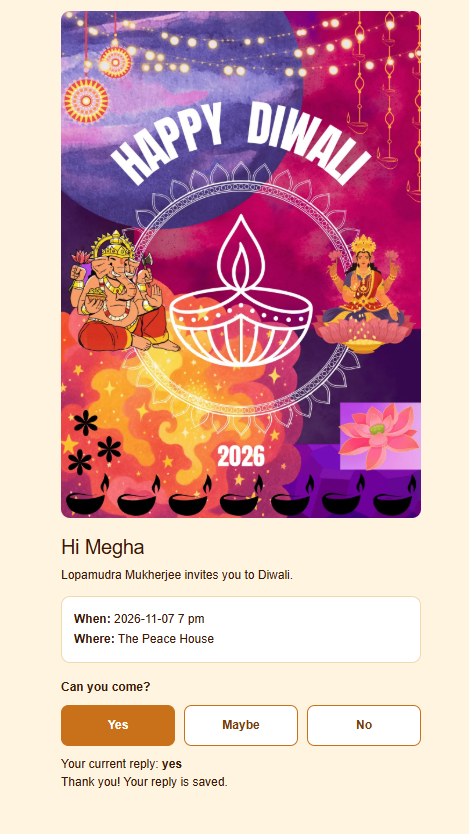
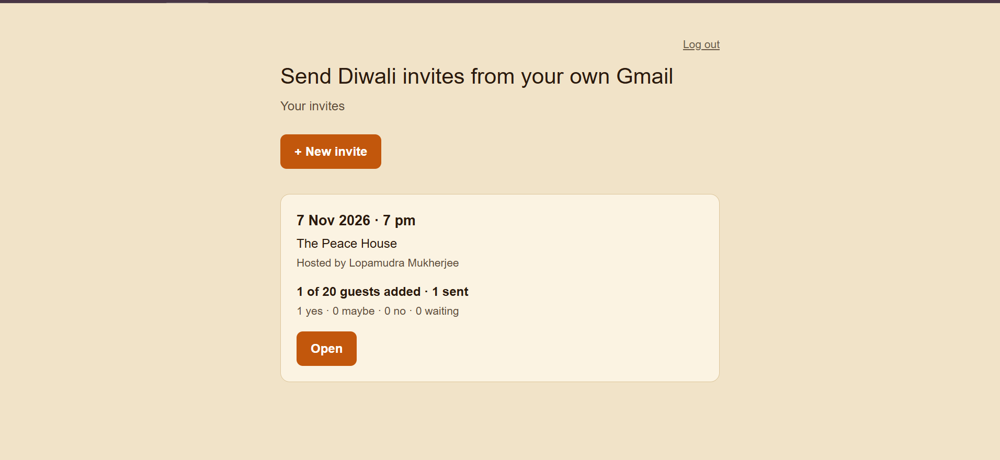
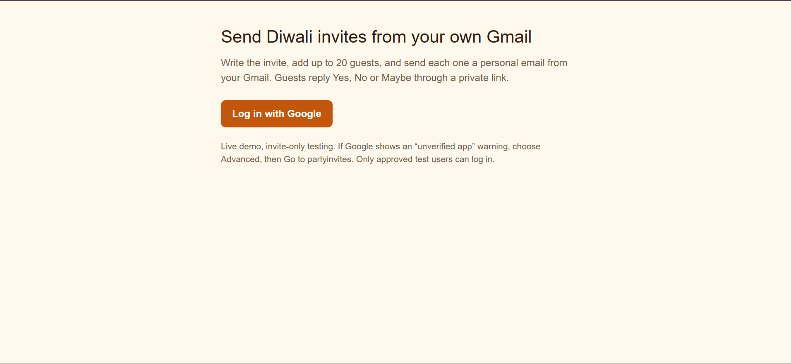
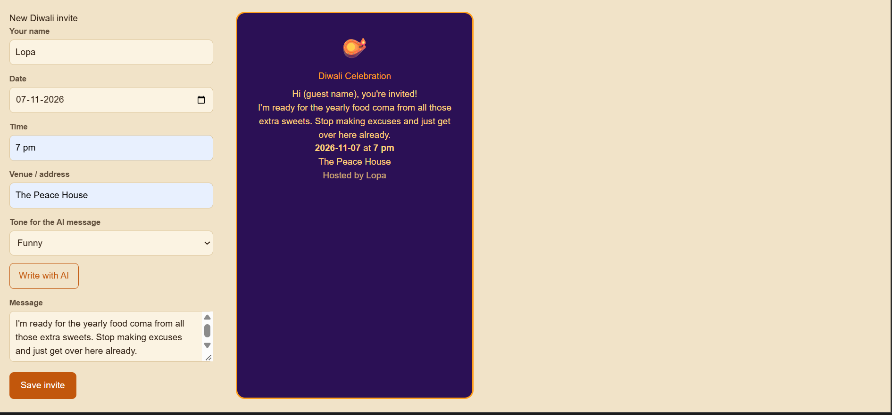

# PartyInvites

Make an invite for an occasion, add your guests, and the app emails each of them a personalized invite **from your own email address**. Guests reply from their phone with one tap, and you see who is coming on a dashboard.

**Live app:** https://partyinvites-76dg.vercel.app





---

## Why I built this

Group chats are a bad way to invite people. Replies get buried, you never know who actually saw the message, and a plain "pls come" text looks lazy for something like Diwali.

I wanted something small enough to build in about 2 days, but real enough that friends could use it without me standing next to them. So the rules were:

- It has to be deployed and usable by other people, not just run on localhost.
- Everything has to be free: no paid services, no bought domain.
- The email should come from the host's own address, so the guest sees a name they know instead of a random `noreply@` sender.
- AI should help with the wording, but the app must still work if AI is down or out of quota.

---

## What it does

### For the host
- Log in with Google.
- Create an invite for an occasion (Diwali first) with a title, date, time, venue and a message.
- Pick one of **3 card designs** and see a live preview.
- Click **Write with AI** and pick a tone: **traditional**, **funny** or **family**. Gemini writes the message for you.
- Add guests (name + email) in a list, save it, and send.
- Open the invite page to see a **replies summary**: who said yes, who said no, who has not answered.
- Your saved invites show up on a dashboard.

### For the guest
- Gets an email with the invite, sent from the host's own Gmail.
- Taps the reply link and lands on a mobile-friendly reply page.
- Answers with one tap. No account, no login.
- The reply page works in light and dark mode.





---

## How it works

```
Host logs in with Google (OAuth)
        |
        v
Host creates invite  --->  (optional) Gemini writes the message
        |                         |
        |                         +--> fallback: ready-made text if AI fails
        v                           or the daily limit is reached
Invite + guests saved in Supabase
        |
        v
Host clicks Send
        |
        v
App sends one email per guest through the host's own Google account
        |
        v
Each email contains a unique reply link  /r/[code]
        |
        v
Guest opens the link, taps a reply  --->  saved in Supabase
        |
        v
Host sees the replies on  /dashboard/[id]
```

### Why the email comes from the host's account
The host signs in with Google and gives permission to send mail on their behalf. Invites go out through their own mailbox. Guests see the host's real name and address, and the app never needs its own sending domain (which would cost money and need DNS setup).

### Reply links
Every guest gets their own reply code. The reply page lives at `app/r/[code]`. A wrong or made-up code shows a 404, so nobody can reply for someone else by guessing a URL.

### AI wording
- Provider: **Google Gemini** (model set in `aiActions.ts`, currently `gemini-3.5-flash-lite`).
- Three tones: traditional, funny, family.
- The prompt is written so the model does **not invent** host names, dates, venues or any event details I didn't give it. My first version did, so I rewrote it.
- **Limit:** 10 AI generations per host per 24 hours, tracked in an `ai_usage` table in Supabase. After that, the app falls back to ready-made text so the host is never blocked.
- The API key lives only in server-side environment variables (`GEMINI_API_KEY`), never in the browser.

---

## Tech stack

| Layer | Tool | Why |
|---|---|---|
| Framework | Next.js (App Router, TypeScript) | Pages and server actions in one project |
| Database | Supabase (Postgres) | Free tier, easy SQL, good dashboard |
| Auth | Google OAuth (testing mode) | Needed for "send from your own email" |
| Email | Sent through the host's Google account | Free, and the sender is a real person |
| AI | Google Gemini | Free tier, used only for invite wording |
| Hosting | Vercel | Free, deploys from GitHub |
| Code | GitHub | Push to deploy |

Total cost: **0**.

---

## Project structure

```
app/
  page.tsx                 landing page
  dashboard/               list of the host's invites
  dashboard/[id]/          one invite: guest list, send, replies summary
  r/[code]/                public guest reply page
components/
  GuestForm                guest list: add row, save, send
  ...                      invite form, card designs, preview
aiActions.ts               Gemini call, tone prompts, usage limit, fallback text
public/
  diwali-card.png          card image used on the reply page
demoScreenshots          screenshots used in this README
```


---

## Database

Main things stored in Supabase:

- **Invites**: owner, occasion, title, date, time, venue, message, chosen design.
- **Guests**: linked to an invite; name, email, unique reply code, reply status (empty until the guest answers).
- **ai_usage**: one row per AI generation per host, used to enforce the 10-per-24-hours limit.


---

## Run it locally

**Needs:** Node.js, a Supabase project, a Google Cloud project, a Gemini API key.

```bash
git clone https://github.com/LOPAMUDRA-MUKHERJEE/partyinvites.git
cd partyinvites
npm install
```

Create `.env.local`:

```
# Supabase
NEXT_PUBLIC_SUPABASE_URL=
NEXT_PUBLIC_SUPABASE_ANON_KEY=
SUPABASE_SERVICE_ROLE_KEY=

# Google OAuth
GOOGLE_CLIENT_ID=
GOOGLE_CLIENT_SECRET=

# Gemini
GEMINI_API_KEY=
```

```bash
npm run dev
```

Open http://localhost:3000.

### Google Cloud setup
1. Create a project in Google Cloud Console.
2. Configure the OAuth consent screen (External, **Testing** mode).
3. Add the permission that lets the app send email.
4. Create OAuth credentials (Web application).
5. Add your URLs under **Authorized JavaScript origins** and the redirect URI. This includes your Vercel address, or login will fail on the live site.
6. Add everyone who should use the app under **Test users**.

### Deploy to Vercel
1. Push the repo to GitHub.
2. Import it in Vercel.
3. Add all the environment variables from `.env.local` in the Vercel project settings.
4. Add the Vercel URL to Google's authorized origins.
5. Deploy.

### Build note
`npm run build` only passed after I turned **Cache Components off** in `next.config.ts`. If your build fails on caching errors, check that setting first.

---

## Known limitations

I would rather list these than have someone find them:

- **Invites can land in spam.** In my tests, the first invite reached the inbox and the second (Gmail to Gmail) went to spam. Email filters judge content and sender history, and I can't control that from the app. Guests may need to check spam.
- **Testing mode.** The Google OAuth app is not verified. Only people I add as test users can log in, and Google shows a warning screen. Verification needs a domain and a review, which is outside the free-only rule.
- **Only Gmail to Gmail is tested.** I have not tested delivery to Yahoo, Outlook or other providers.
- **10 AI generations per host per day.** After that, ready-made text is used.
- **One occasion style so far.** Diwali is built; other occasions (Halloween, birthdays) reuse the same flow but need their own designs.

---

## Testing

I tested on the live site, not just localhost:

- Google login on the deployed URL (including incognito).
- Create invite, add guests, send, open the email, tap the reply link on a phone, check the reply shows on the host page.
- Wrong reply code returns 404.
- AI daily limit reached, and the app fell back to ready-made text.
- Reply page in light and dark mode on a phone.
- Two real friend tests, end to end.

---

## Build log

### Build log
| Day | What got done |
| **Day 1** | Google Cloud & OAuth setup, Google login, invite form structure, 3 card designs, live preview, and dashboard |
| **Day 2** | Guest list management, sending emails via the host's Gmail, first deployment to Vercel, guest reply page (`/r/[code]`), and host replies summary |
| **Day 3** | Gemini AI integration with tone picker (traditional, funny, family), 24-hour usage limits & fallback text, friend testing, final styling pass, and README |

### Things that went wrong
- **Model name stopped working.** The Gemini model I started with was no longer available. The error message listed current names, so I switched to one from that list.
- **AI invented details.** Early prompts made Gemini add hosts, places and times I never gave it. I rewrote the prompt so it only uses the details I pass in.
- **Build failing on Vercel.** Fixed by turning Cache Components off.
- **Google login on the live site.** It only worked after adding the Vercel URL to Authorized JavaScript origins.
- **Date field looked blank on phone.** I added visible labels above the form fields.
- **Buttons too close together** on the guest form. Spacing fixed.

---

## What I would add next (v2)

- More occasions and card designs (Halloween, birthdays, weddings or any part events).
- Reminder emails for guests who haven't replied.
- A public invite link for people who don't have a guest list.
- A find parties near me option.
- Reply options with a plus-one count.
- A custom domain and Google verification, which would remove the warning screen and help with spam.
- Option to delete events and triger mail to the guests informing them of the same.

---

## Author

**Lopamudra Mukherjee**
B.Tech CSE, 2026 grad, KIIT DU
GitHub: [LOPAMUDRA-MUKHERJEE](https://github.com/LOPAMUDRA-MUKHERJEE)
LinkedIn: `<www.linkedin.com/in/lopamudra-mukherjee>`